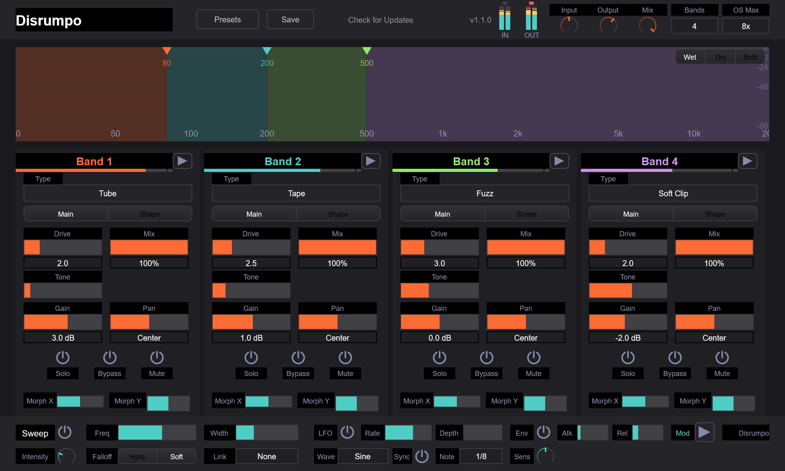
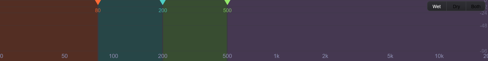
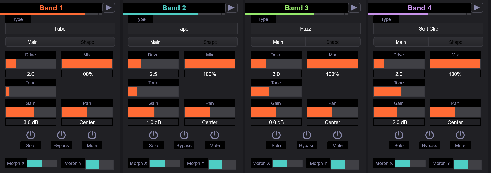
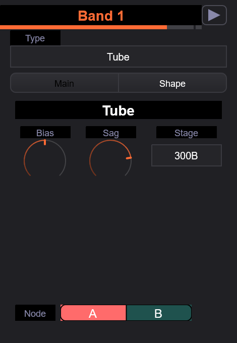
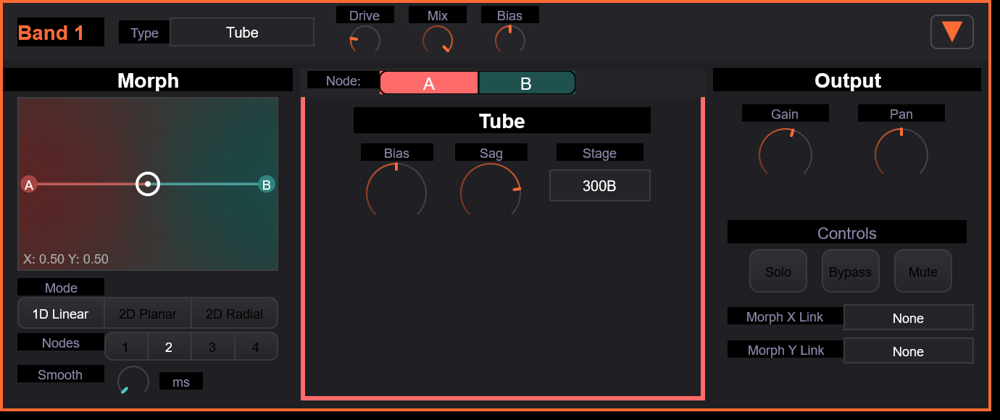
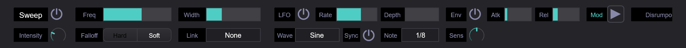
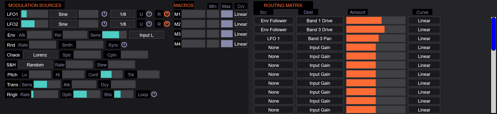

# Disrumpo — User Manual

## Introduction

Disrumpo is a **multiband morphing distortion**. It splits the signal into up to four frequency bands and distorts
each band on its own, with 26 distortion algorithms in seven families: saturation, wavefolding, rectification, digital
destruction, dynamic, hybrid and experimental processing. Each band holds up to four distortion **nodes** and blends
between them with a **MorphPad**, so a band can move smoothly from warm tube drive to a folded, bit-crushed snarl.
The **Sweep** system aims extra drive at one region of the spectrum and moves it with an LFO or the input's
envelope, and a 32-route **modulation matrix** with eleven kinds of modulation source can move almost everything else.

**Formats:** VST3 (Windows, macOS, Linux) and Audio Unit (macOS). Stereo in, stereo out. Left and right are processed
separately all the way through.

## Signal Flow

```
Stereo in
  │
  ├──────────────────────────────── dry path (before Input Gain), phase- and
  │                                  latency-matched to the bands
  ▼
Input Gain
  │
  ▼
Crossover ─────────── 1 to 4 bands, Linkwitz-Riley 24 dB/oct
  │
  ▼
Per band ──────────── oversample ↑ → up to 4 distortion nodes blended by the
  │                   MorphPad → oversample ↓ → Gain, Pan, Mute
  ▼
Σ bands ──────────── Solo and Mute decide which bands are heard
  │
  ▼
Mix ──────────────── dry × (1 − Mix) + wet × Mix
  │
  ▼
Output Gain → safety clipper → Stereo out
```

The Sweep and the modulation matrix run once per processing block and steer the stages above: the Sweep multiplies
each band's drive, and the matrix offsets gains, the Mix, the morph positions and the nodes' drive, mix, tone and bias.
The interactive signal-flow diagram on the Disrumpo page shows every connection.

Two details are worth knowing:

- **Input Gain drives the bands only.** The dry path is taken before it, so Input Gain changes how hard the bands are
  driven without changing the dry level.
- **The safety clipper is always on.** Below −6 dBFS it passes the signal untouched; above that it rounds peaks off
  softly so the output never exceeds −0.18 dBFS.

## Interface Overview



The editor is 1000 × 600, and 830 tall when the modulation panel is open. From top to bottom:

- **The header** — presets, update check, version, level meters and the global controls.
- **The spectrum** — the analysed spectrum behind the band regions, with the crossover handles.
- **The bands** — one panel per band, each with its own type, drive, morph and output controls.
- **The sweep row** — the Sweep, its LFO and envelope follower, and the **Mod** button that opens the modulation panel.

Every control can be MIDI-learned: right-click it and choose **MIDI Learn**, then move a controller. A learned control
offers **Clear MIDI Learn** and **Save Mapping with Preset** (which keeps the mapping with the preset instead of
globally). Esc cancels a learn in progress.

**Keyboard:** Tab and Shift+Tab move between the active bands; Space toggles Bypass on the focused band; the arrow keys
move the focused control by 1 % of its range (10 % with Shift, one step on stepped controls).

## Header


| Control | Host name | Range | Default | What it does |
|---|---|---|---|---|
| Input | Input Gain | −24 to +24 dB | 0 dB | Drive into the bands (the dry path is taken before it). |
| Output | Output Gain | −24 to +24 dB | 0 dB | Output level, after the Mix. |
| Mix | Mix | 0–100 % | 100 % | Dry/wet balance. |
| Bands | Band Count | 1, 2, 3, 4 | 4 | Number of bands. Changing it dips the output for 5 ms to switch cleanly. |
| OS Max | Oversample Max | 1x, 2x, 4x, 8x | 8x | The most oversampling any band may use (see below). |

- **Presets** opens the preset browser and **Save** opens the save dialog (see Presets).
- **Check for Updates** reads "Checking..." and then "Up to date", or shows a banner with a **Download** button.
- **IN / OUT meters** show the level after Input Gain and the final output. The clip light at the top of OUT reads the
  signal before the safety clipper, so it shows when the clipper is catching peaks; click a meter to clear it.

**Oversampling.** Each distortion type has a recommended oversampling factor, chosen to keep its aliasing down: 8x for
Tape, Temporal, the three folders, Fuzz, Asymmetric Fuzz and Allpass Resonant; 4x for Soft Clip, Hard Clip, the two
rectifiers, Ring Saturation, Feedback and Formant; 2x for Tube, Chaos, Granular, Fractal and Stochastic; and 1x for the
digital types and Spectral, whose aliasing is part of the sound. A band uses the factors of its active nodes, weighted
by the morph, capped by **OS Max**. A band whose drive is 0 everywhere runs without oversampling. Lower OS Max to save
CPU.

## Spectrum and Crossovers



The spectrum runs from 20 Hz to 20 kHz. Each band's region is tinted in its colour (Band 1 orange, Band 2 teal,
Band 3 green, Band 4 violet), with the live spectrum and peak-hold lines over it. When the Sweep is on, the display also
shows its curve and how strongly it reaches each band.

| Control | Host name | Range | Default | What it does |
|---|---|---|---|---|
| Wet / Dry / Both | Spectrum Mode | Wet, Dry, Both | Wet | What the display analyses: the output, the input, or both (input faint, output over it). Display only. |
| Crossover handles | Crossover 1 · Crossover 2 · Crossover 3 | 20 Hz – 20 kHz | about 112 Hz, 632 Hz, 3.56 kHz | Where the bands split. |

**Moving a crossover:** drag the triangle handle at the top of a divider. Hovering or dragging shows its exact
frequency. A crossover always stays at least half an octave from its neighbours. Only as many handles as there are
band splits are shown; with one band there are none.

## Bands



Each band panel shows the band's name and level meter, a chevron that opens the expanded strip, the **Type** of the
selected node and two tabs, **Main** and **Shape**.

**Main tab:**

| Control | Host name | Range | Default | What it does |
|---|---|---|---|---|
| Type | Type (of the selected node) | the 26 types | Soft Clip | The distortion algorithm of the selected node. |
| Drive | Drive (of the selected node) | 0–10 | 1.0 | How hard the node is driven. 0 passes the signal untouched. |
| Mix | Mix (of the selected node) | 0–100 % | 100 % | The node's own dry/wet. |
| Tone | Tone (of the selected node) | 200 Hz – 8 kHz | 4 kHz | A low-pass on the node's distorted signal (not on the digital types). |
| Gain | Gain | −24 to +24 dB | 0 dB | Band output level. |
| Pan | Pan | −1 to +1 | Center | Band balance. |
| Solo | Solo | Off / On | Off | When any band is soloed, only soloed bands are heard. |
| Bypass | Bypass | Off / On | Off | The band passes its input through unprocessed (still time-aligned). |
| Mute | Mute | Off / On | Off | Silences the band. Mute wins over Solo. |
| Morph X / Morph Y | Morph X · Morph Y | 0–1 | 0.5 | The band's position on its MorphPad. |

Drive, Mix, Tone, Gain and Pan draw the live modulation range around their value when the modulation matrix moves them.

**Shape tab:**



The Shape tab shows the controls of the selected node's type (see Distortion Types) and, when the band has more than
one active node, a **Node** A–D selector that chooses which node the panel edits. Every type keeps its own shape
settings, so switching a node to another type and back restores them.

### The expanded strip



The chevron opens a wide strip over the band area with everything for that band at once:

- **The header row:** Type, Drive and Mix of the selected node, and **Bias** when the type has a bias control (Tube,
  Tape, Fuzz, Asymmetric Fuzz, the three folders and Ring Saturation).
- **Morph:** the MorphPad, **Mode**, **Nodes** and **Smooth**.
- **The node editor:** the **Node** selector and the selected node's shape controls.
- **Output:** Gain, Pan, Solo, Bypass, Mute and the two morph links.

| Control | Host name | Range | Default | What it does |
|---|---|---|---|---|
| Bias | Bias (of the selected node) | −1 to +1 | 0 | Asymmetry of the curve, for even harmonics. |
| Mode | Morph Mode | 1D Linear, 2D Planar, 2D Radial | 1D Linear | How the MorphPad position blends the nodes. |
| Nodes | Active Nodes | 1, 2, 3, 4 | 1 | How many nodes (A–D) the band blends. |
| Smooth | Morph Smoothing | 0–500 ms | 0 ms | Glide time of the morph position. |
| Node | Selected Node | Node A, Node B, Node C, Node D | Node A | Which node the type, drive, mix, tone, bias and shape controls edit. |
| Morph X Link | Morph X Link | None, Sweep Freq, Inverse Sweep, Ease In, Ease Out, Hold-Rise, Stepped, Custom | None | Lets the sweep frequency drive the band's Morph X (see Sweep). |
| Morph Y Link | Morph Y Link | the same list | None | The same for Morph Y. |

### Nodes and the MorphPad

Each band has four nodes, **A**, **B**, **C** and **D**; **Nodes** sets how many take part. Every node has its own type,
drive, mix, tone, bias and shape settings. The MorphPad blends the active nodes by the position of its cursor:

- **1D Linear** uses X only: the nodes sit on a horizontal line (A at the left end, B at the right end, C in the
  middle, D three quarters of the way along) and the cursor crossfades between neighbours. Drag a node along the line to move it;
  its place on the line is separate from its place in the 2D modes, so switching modes moves nothing.
- **2D Planar** weighs each node by the cursor's distance to it. The nodes start at the corners (A bottom-left,
  B bottom-right, C top-left, D top-right); drag them anywhere on the pad.
- **2D Radial** weighs the nodes by angle around the centre: at the centre all nodes mix equally, at the edge the angle
  picks the blend. A node's angle comes from where it sits on the pad.

When every active node uses the same type, the band runs that type once with its settings blended by the morph. When
the types differ, the nodes run side by side and their outputs are mixed by weight. Either way, adding a node, removing
one or changing a type crossfades over a few milliseconds.

**Using the pad:** click or drag to move the cursor; hold Shift for fine moves; double-click to return to the centre;
the mouse wheel moves X (and the horizontal wheel Y). Click a node to select it for editing, as the **Node** selector
does, and drag a node to move it: the band blends by where the nodes sit, so moving a node reshapes the blend. In
1D Linear a node slides along the line only. Node positions are saved with the project and presets and can be
automated (host names **Pos X** and **Pos Y** for the 2D modes, **Line Pos** for 1D Linear). Projects and presets
saved before Disrumpo 1.1.0 keep the even spacing on the line they had. The pad follows the band's **Mode**: the readout in the corner shows the position, and lines
from the cursor to each node fade with that node's weight in the current mode. With one active node the pad is greyed
out.

## Distortion Types

The Type menu lists the 26 types. The families group related sounds:

| Family | Types |
|---|---|
| Saturation | Soft Clip, Hard Clip, Tube, Tape, Fuzz, Asymmetric Fuzz |
| Wavefold | Sine Fold, Triangle Fold, Serge Fold |
| Rectify | Full Rectify, Half Rectify |
| Digital | Bitcrush, Sample Reduce, Quantize, Aliasing, Bitwise Mangler |
| Dynamic | Temporal, Feedback |
| Hybrid | Ring Saturation, Allpass Resonant |
| Experimental | Chaos, Formant, Granular, Spectral, Fractal, Stochastic |

Each type's Shape page shows its own controls. "%" controls run 0–100 %, "±1" controls run −1 to +1, and a "curve"
control chooses one of nine saturation curves (Tanh, Atan, Cubic, Quintic, RSqrt, Erf, HardClip, Diode, Tube).

| Type | Sound | Shape controls |
|---|---|---|
| Soft Clip | Warm, rounded saturation, mostly odd harmonics. | Curve %, Knee % |
| Hard Clip | Flat-topped clipping with a full, harsh harmonic series. | Threshold %, Ceiling % |
| Tube | Asymmetric valve stage, rich in even harmonics. | Bias ±1, Sag %, Stage (12AX7, EL84, 6L6, 300B) |
| Tape | Tape saturation with optional magnetic hysteresis. | Bias ±1, Sag %, Speed %, Model (Simple, Hysteresis), HF Roll %, Flutter % |
| Fuzz | Germanium-style fuzz with a sagging, "dying battery" response. | Bias ±1, Transistor (Germanium, Silicon), Octave %, Sustain % |
| Asymmetric Fuzz | Brighter, tighter silicon-style fuzz. | Bias ±1, Asym %, Trans (Germanium, Silicon), Sustain %, Body % |
| Sine Fold | Serge-style sine folding: sparse, FM-like spectra. | Folds 1–12, Symmetry ±1, Shape %, Bias ±1, Smooth % |
| Triangle Fold | Mirror folding with dense odd harmonics. | Folds 1–12, Symmetry ±1, Angle %, Bias ±1, Smooth % |
| Serge Fold | Circuit-modelled folder with spectral nulls. | Folds 1–12, Symm ±1, Model (Serge, Simple, Buchla, Lockhart), Bias ±1, Shape %, Smooth % |
| Full Rectify | Absolute value: an octave up, every harmonic. | Smooth %, DC Block (on/off) |
| Half Rectify | One half of the wave only: asymmetric and gated. | Threshold %, Smooth %, DC Block (on/off) |
| Bitcrush | Reduced bit depth for quantisation grit. | Bits 4–16, Dither %, Mode (Truncate, Dither), Jitter % |
| Sample Reduce | Reduced sample rate: aliasing and stepped waveforms. | Rate 1–32x, Jitter %, Mode (ZOH, Linear), Smooth % |
| Quantize | Amplitude stepped into levels. | Levels %, Dither %, Smooth %, Offset % |
| Aliasing | Deliberate aliasing with frequency shifting: metallic, inharmonic. | Down 2–32x, Shift −5000 to +5000 Hz |
| Bitwise Mangler | Bit operations on the samples: glitchy, noisy textures. | Op (XorPat, XorPrev, BitAnd, Overflow), Intensity %, Pattern % (XorPat only) |
| Temporal | Distortion that follows the input's dynamics. | Mode (Follow, Inverse, Transient, Hyst), Sens %, Curve, Atk 1–500 ms, Rel 10–5000 ms; Depth % and Hold 1–500 ms in Hyst |
| Feedback | A distorting feedback loop with a filter inside. | FB 0–1.5, Delay 1–100 ms, Curve, Filter (Off, LP, BP, HP), Freq %, Stage (1x–4x), Lim (on/off), Thr %, Decay % |
| Ring Saturation | Ring modulation blended with saturation. | Mod %, Stages 1–4, Curve, Carrier (Sine, Triangle, Square, Saw), Bias ±1, Freq (Fixed, Harmonic, Track, Random), Hz (20–5000 Hz in Fixed, a 1–16x ratio in Harmonic) |
| Allpass Resonant | Saturated allpass network: resonant, ringing peaks. | Topo (Single, Chain, Karplus, Matrix), Freq 20–2000 Hz, FB 0–0.99, Decay 0.01–10 s, Drive %, Curve (Tanh, Clip, Asym, Hyst), Damp % |
| Chaos | Waveshaping driven by a chaotic attractor. | Attr (Lorenz, Rossler, Chua, Henon), Spd 0.01–100, Amt %, Coup %, X-Dr %, Y-Dr %, Smth % |
| Formant | Vowel resonances with distortion: vocal, talking tones. | Vowel (A, E, I, O, U), Shift ±24 st, Curve %, Reso %, BW %, Fmts (2–5), Gendr %, Blend % |
| Granular | Distortion in short grains: cloudy, broken textures. | Size 5–100 ms, Dens %, PVar %, DVar %, Pos %, Curve %, Env (Hann, Trap, Sine, Blk) |
| Spectral | Distortion per frequency bin. | Mode (PerBin, MagOnly, Selective, Bitcrush), FFT (512–4096), Curve, Tilt %, Thr %, Mag (Linear, Log, Bark, ERB), Freq %, Phase (Preserve, Random, Gradient, Temporal) |
| Fractal | Recursive, self-similar distortion. | Mode (Residual, Multiband, Harmonic, Cascade, Feedback), Iter 1–8, Scale 0.3–0.9, Curve, FDecay %, FB 0–0.5 (Feedback mode), Blend (Add, Multiply, Max, Screen), Depth % (Multiband mode) |
| Stochastic | Noise-modulated distortion: shimmering and diffuse. | Curve (Tanh, Atan, Cubic, Qntc, RSqrt, Erf), Jit %, Rate 0.1–100 Hz, Coef %, Drift %, Corr (None, Sample, Param, Both), Smth %, Dist (White, Pink, Brown, Blue, Violet) |

## Sweep



The Sweep focuses extra drive on one region of the spectrum. Each band's drive is multiplied by up to 2× depending on
how close the band's centre lies to the sweep frequency: **Width** sets how far the boost reaches, **Falloff** whether
it ends sharply (Hard) or in a bell curve (Soft), and **Intensity** how strong it is. The sweep frequency can move on
its own with the sweep **LFO** (up to ±2 octaves) and the **Env** follower, which pushes it upwards (up to +2 octaves)
as the input gets louder.

| Control | Host name | Range | Default | What it does |
|---|---|---|---|---|
| Sweep | Sweep Enable | Off / On | Off | Switches the Sweep. |
| Freq | Sweep Frequency | 20 Hz – 20 kHz | 1 kHz | Centre of the sweep. |
| Width | Sweep Width | 0.5–4.0 octaves | 1.5 oct | How far the boost reaches either side. |
| Intensity | Sweep Intensity | 0–200 % | 50 % | Strength of the drive boost. |
| Falloff | Sweep Falloff | Hard, Soft | Soft | A straight-line or bell-shaped edge. |
| Link | Sweep Morph Link | None, Sweep Freq, Inverse Sweep, Ease In, Ease Out, Hold-Rise, Stepped, Custom | None | Drives Morph X of every band whose own Morph X Link is None. |
| LFO | Sweep LFO Enable | Off / On | Off | Switches the sweep LFO. |
| Rate | Sweep LFO Rate | 0.01–20 Hz | 1 Hz | LFO speed (free). |
| Wave | Sweep LFO Waveform | Sine, Triangle, Sawtooth, Square, S&H, Random | Sine | LFO shape. |
| Depth | Sweep LFO Depth | 0–100 % | 50 % | LFO depth (100 % = ±2 octaves). |
| Sync | Sweep LFO Sync | Off / On | Off | Locks the LFO to the host tempo. |
| Note | Sweep LFO Note | 1/64T … 4/1D | 1/8 | The synced LFO period. |
| Env | Sweep Env Enable | Off / On | Off | Switches the envelope follower. |
| Atk | Sweep Env Attack | 1–100 ms | 10 ms | Follower attack. |
| Rel | Sweep Env Release | 10–500 ms | 100 ms | Follower release. |
| Sens | Sweep Env Sensitivity | 0–100 % | 50 % | How far the input level moves the sweep. |

### Linking the morph to the sweep

A morph link turns the sweep frequency (from 20 Hz to 20 kHz, as a 0–1 position) into a MorphPad position, so the
distortion character changes as the sweep moves. **Sweep Freq** follows it directly, **Inverse Sweep** runs the other
way, **Ease In** and **Ease Out** curve it, **Hold-Rise** holds and then rises, and **Stepped** moves in steps.
**Custom** follows a curve of up to eight points that is stored with the preset; its points are the host parameters
**Curve Point Count** and **Curve P0 X** to **Curve P7 Y**. The link works whenever it is set, whether or not the Sweep
itself is on.

## Modulation



**Mod** at the right of the sweep row opens the modulation panel below the editor: the modulation sources on the
left, four macros in the middle and the routing matrix on the right.

### Sources

| Row | Controls (host names) |
|---|---|
| LFO1, LFO2 | Rate (LFO 1 Rate: 0.01–20 Hz), Shape (LFO 1 Shape: Sine, Triangle, Saw, Square, S&H, Smooth Random), Phase (LFO 1 Phase: 0–360°), Sync (LFO 1 Sync), Note (LFO 1 Note Value), U = unipolar (LFO 1 Unipolar), R = retrigger on transport start (LFO 1 Retrigger); the same for LFO 2 Rate, LFO 2 Shape, LFO 2 Phase, LFO 2 Sync, LFO 2 Note Value, LFO 2 Unipolar, LFO 2 Retrigger |
| Env | Atk (Env Attack: 1–100 ms), Rel (Env Release: 10–500 ms), Sens (Env Sensitivity), source (Env Source: Input L, Input R, Input Sum, Mid, Side) |
| Rnd | Rate (Random Rate: 0.1–50 Hz), Smth (Random Smoothness), Sync (Random Sync) |
| Chaos | model (Chaos Model: Lorenz, Rossler, Chua, Henon), Spd (Chaos Speed: 0.05–20x), Cpln (Chaos Coupling: 0–1) |
| S&H | source (S&H Source: Random, LFO 1, LFO 2, External), Rate (S&H Rate: 0.1–50 Hz), Slew (S&H Slew: 0–500 ms) |
| Pitch | Lo (Pitch Min Hz: 20–500), Hi (Pitch Max Hz: 200–5000), Conf (Pitch Confidence), Trk (Pitch Tracking: 10–300 ms) |
| Trans | Sens (Transient Sensitivity), Atk (Transient Attack: 0.5–10 ms), Dcy (Transient Decay: 20–200 ms) |
| Rnglr | Rate (Rungler Rate: 0.1–50 Hz), Dpth (Rungler Depth), Bits (Rungler Bits: 4–16), Loop (Rungler Loop) |

The Env follower, Pitch and Transient sources listen to the input before Input Gain.

### Macros

**M1–M4** (Macro 1, Macro 2, Macro 3, Macro 4) are four knobs you can route like any other source, for one-knob control
of several destinations at once. Each has a **Min** and a **Max** (host names Macro 1 Min, Macro 1 Max, Macro 2 Min,
Macro 2 Max, Macro 3 Min, Macro 3 Max, Macro 4 Min, Macro 4 Max) that set the range it sweeps, and a curve (**Crv**,
host name Macro Curve: Linear, Exponential, S-Curve, Stepped).

### Routing matrix

The matrix has 32 routes; scroll the list to reach them all. Each route has:

| Column | Host name | Range | What it does |
|---|---|---|---|
| Src | Route Source | None, LFO 1, LFO 2, Env Follower, Random, Macro 1–4, Chaos, Rungler, S&H, Pitch, Transient | The modulation source. |
| Dest | Route Dest | Input Gain, Output Gain, Global Mix, Sweep Freq, Sweep Width, Sweep Intensity, and for each band Morph X, Morph Y, Drive, Mix, Gain, Pan, Tone, Bias | What it moves. |
| Amount | Route Amount | −100 to +100 % | How far, and in which direction. |
| Curve | Route Curve | Linear, Exponential, S-Curve, Stepped | The response curve. |

A band's Drive, Mix, Tone and Bias destinations move every node of that band.

## Presets

**Presets** in the header opens the preset browser: tabs for **All** and each category, a search field, and buttons to
save, import and delete your own presets. Double-click a preset to load it. **Save** in the header opens a dialog to
name a preset and choose its category.

### Factory library

Disrumpo ships 120 factory presets in eleven categories. The browser shows them by file name.

- **Init** — `Init_1_Band`, `Init_2_Bands`, `Init_3_Bands`, `Init_4_Bands`
- **Sweep** — `Ease_In_Morph`, `Envelope_Follower`, `Frequency_Hunter`, `High_Sweep`, `Inverse_Link`, `Low_Rumble`,
  `Random_Scan`, `Resonant_Sweep`, `Sharp_Focus`, `Slow_Scan`, `Step_Scanner`, `Synced_Pulse`, `Triangle_Wobble`,
  `Wah_Wah_Drive`, `Wide_Sweep`
- **Morph** — `Chaos_to_Order`, `Digital_Organic`, `Feedback_Explorer`, `Formant_Shift`, `Four_Corners`,
  `Multi_Band_Morph`, `Radial_Blend`, `Rectify_Blend`, `Smooth_Crossfade`, `Soft_to_Hard`, `Spectral_Morph`,
  `Tape_Fold_Morph`, `Three_Node_Blend`, `Tube_to_Fuzz`, `Wavefolder_Quad`
- **Bass** — `Dirty_Sub`, `Multi_Band_Bass`, `Punchy_Low_End`, `Ring_Bass`, `Serge_Bass`, `Soft_Bass_Drive`,
  `Subharmonic_Growl`, `Tape_Warmth`, `Warm_Bass`, `Wavefold_Bass`
- **Leads** — `Asymmetric_Bite`, `Chaos_Lead`, `Feedback_Scream`, `Fractal_Lead`, `Fuzz_Face`, `Modulated_Edge`,
  `Ring_Mod_Lead`, `Screaming_Lead`, `Temporal_Edge`, `Wavefold_Lead`
- **Pads** — `Allpass_Shimmer`, `Evolving_Texture`, `Formant_Pad`, `Gentle_Warmth`, `Granular_Wash`, `Slow_Morph_Pad`,
  `Soft_Sweep`, `Spectral_Pad`, `Stochastic_Drift`, `Tape_Haze`
- **Drums** — `Aliased_Drums`, `Crushed_Beats`, `Dirty_Groove`, `Glitch_Drum`, `Kick_Saturate`, `Punchy_Clip`,
  `Rectified_Drums`, `Snare_Crack`, `Temporal_Snap`, `Transient_Shape`
- **Experimental** — `Alien_Voice`, `All_Types_Morph`, `Bitwise_Mangler`, `Broken_Radio`, `Chaos_Engine`,
  `Feedback_Loop`, `Formant_Shift`, `Formant_Vowels`, `Fractal_Noise`, `Granular_Crush`, `Quantize_Glitch`,
  `Ring_Chaos`, `Serge_Madness`, `Spectral_Scatter`, `Stochastic_Burst`, `Temporal_Flux`
- **Chaos** — `Attractor_Pan`, `Chaos_Morph_4`, `Chaotic_Sweep`, `Chua_Circuit`, `Coupled_Chaos`, `Fast_Chaos`,
  `Henon_Map`, `Lorenz_Drive`, `Rossler_Morph`, `Slow_Chaos`
- **Dynamic** — `Dynamic_Mix`, `Envelope_Morph`, `Multi_Dynamic`, `Pitch_Drive`, `Pitch_Tracker`, `Sidechain_Pump`,
  `Touch_Sensitive`, `Transient_Gate`, `Transient_Punch`, `Velocity_Response`
- **Lo-Fi** — `4-Bit_Retro`, `8-Bit_Crunch`, `Aliasing_Harsh`, `Bit_Mangler`, `Digital_Decay`, `Glitch_Box`,
  `Multi_Band_Lo-Fi`, `Quantize_Dirt`, `Sample_Rate_Crush`, `Warm_Lo-Fi`

## Host Automation

Disrumpo's host parameter names follow a pattern for the per-band and per-node controls:

- **Per band:** `Band <n> <control>`, for example **Band 2 Gain**. The per-band controls are Gain, Pan, Solo, Bypass,
  Mute, Morph X, Morph Y, Morph Mode, Active Nodes, Morph Smoothing, Morph X Link, Morph Y Link and Selected Node, plus
  editor state that is saved but not meant for automation: Expanded, Tab View and Displayed Type.
- **Per node:** `B<band> N<node> <control>`, for example **B3 N1 Drive** (band 3, node A). The per-node controls are
  Type, Drive, Mix, Tone, Bias, Folds, BitDepth, Pos X and Pos Y (the node's place on the MorphPad in the 2D modes),
  Line Pos (its place on the 1D Linear line), plus Shape 0 to
  Shape 9, the type's shape controls in the order the
  Shape page lists them. Folds and BitDepth are taken over by the shape controls of the folder and bit-crush types.
- **Matrix routes:** all 32 routes share the names Route Source, Route Dest, Route Amount and Route Curve, in route
  order.
- **Editor state:** Mod Panel Visible (whether the modulation panel is open) and Spectrum Mode are saved with the
  session. Displayed Drive, Displayed Mix, Displayed Tone, Displayed Bias and Displayed Shape are the band panel's
  controls for the selected node: they forward to that node's own parameters, so automate the per-node names instead.
  MIDI Learn Active and MIDI Learn Target belong to MIDI learn and are not meant for automation.

## Tips & Tricks

- **Start from Init:** the Init presets set up one to four clean bands at Drive 1, ready to build on.
- **Tame the low end:** distort the mids and highs hard and give the lowest band a gentle Soft Clip or Tube, or Bypass
  it, so the bass stays solid.
- **Moving distortion:** two nodes of different types, Morph Mode 1D Linear, and an LFO routed to the band's Morph X.
- **Wah-style drive:** Sweep on, Width 1 octave, Intensity 150 %, Env follower on: the drive climbs with the playing.
- **Save CPU:** lower OS Max to 2x while writing and raise it again for the mixdown.
