# Iterum — User Manual

## Introduction

Iterum is a **multi-mode delay**: ten complete delay engines in one plugin, from vintage tape and bucket-brigade
echoes to granular clouds, spectral smears, pitch-shifted shimmer and frozen rhythmic loops. One engine plays at a
time. Pick a mode and the editor shows that engine's controls; switch modes while audio is running and Iterum
crossfades from the old engine to the new one over 50 ms, so a change of character never clicks.

Every mode keeps the same layout language: its main time control, **Feedback** and **Mix** sit in the same three
places at the top of every panel, and the rest of the panel is grouped into labelled sections. Delay times lock to the
host tempo, and every mode comes with ten or more factory presets to start from.

**Formats:** VST3 (Windows, macOS, Linux) and Audio Unit (macOS). Stereo in, stereo out.

## Signal Flow

```
Stereo in
  │
  ▼
Mode ─────────────── one of ten engines; a mode switch runs the old and the new
  │                  engine side by side for 50 ms and crossfades between them
  ▼
Delay engine ─────── taps its own dry signal, runs its delay and feedback path,
  │                  and mixes dry and wet with its own Mix control
  ▼
Gain ─────────────── output level, −∞ to +6 dB
  │
  ▼
Stereo out
```

There is no separate global dry/wet control: each mode's **Mix** is the dry/wet balance. Each mode section below
describes what happens inside that engine, and the interactive signal-flow diagram on the Iterum page shows every
engine's chain, including what sits inside each feedback loop.

## Interface Overview

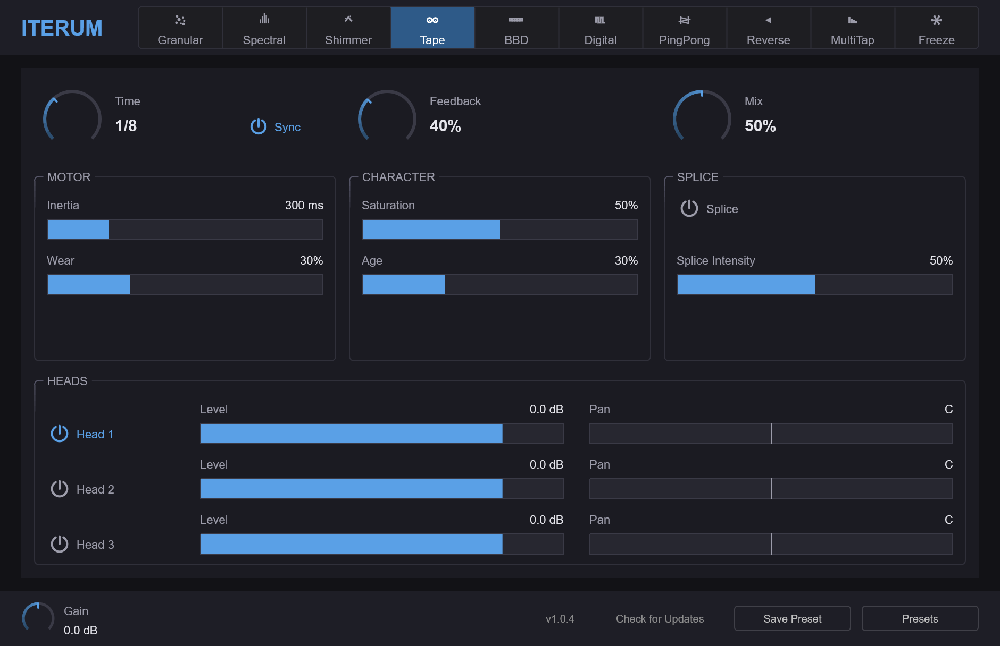

The editor is a fixed 940 × 608 window in three parts.


- **The header** holds the **Mode** selector: ten buttons, Granular, Spectral, Shimmer, Tape, BBD, Digital, PingPong,
  Reverse, MultiTap and Freeze. A new instance starts in **Digital**. When an update is available, a banner appears over
  the header with a **Download** button and a dismiss button.
- **The mode panel** in the middle shows the controls of the selected mode.
- **The footer** holds the output **Gain** knob, the version number, **Check for Updates**, **Save Preset** and
  **Presets**.


| Control | Host name | Range | Default | What it does |
|---|---|---|---|---|
| Mode | Mode | Granular … Freeze | Digital | Selects the delay engine. Switching crossfades over 50 ms. |
| Gain | Gain | −∞ to +6 dB | 0.0 dB | Output level after the delay engine. |

**Check for Updates** asks krateaudio.com for a newer version; it reads "Checking..." and then "Up to date" for a few
seconds, or shows the update banner. Iterum also checks once each time the editor opens.

### Reading the panels

- Knobs and sliders show their value next to them. Drag to change a value.
- Time readouts show milliseconds below one second (`499.0 ms`) and seconds from one second up (`1.25 s`).
- Centre-zero sliders (Pitch, Feedback Tilt, Symmetry, Pan) fill from the middle.

## Time, Sync, Feedback and Mix

Eight modes (Granular, Spectral, Shimmer, Tape, BBD, Digital, PingPong and Reverse) have a **Sync** switch next to
their main time control.

- **Sync on** (the default): the time knob chooses a **note value** and the delay follows the host tempo. The list
  runs from 1/64T to 4/1D: 1/64T, 1/64, 1/64D, 1/32T, 1/32, 1/32D, 1/16T, 1/16, 1/16D, 1/8T, 1/8, 1/8D, 1/4T, 1/4,
  1/4D, 1/2T, 1/2, 1/2D, 1/1T, 1/1, 1/1D, 2/1T, 2/1, 2/1D, 3/1T, 3/1, 3/1D, 4/1T, 4/1, 4/1D (T = triplet,
  D = dotted). The default is **1/8**.
- **Sync off**: the same knob sets the time in milliseconds.

The knob keeps its label ("Time", or "Chunk Size" in Reverse) in both states; only its readout changes. In the host's
automation list the two values are separate parameters, for example **Tape Time Mode**, **Tape Motor Speed** (the free
time) and **Tape Note Value** (the synced time). Without a host tempo Iterum assumes 120 BPM.

**Feedback** runs from 0 to 120 % in every mode except MultiTap (0 to 110 %). Above 100 % the repeats grow instead of
dying away: the range for swelling, self-oscillating textures. Ride it back below 100 % to let the delay settle.

**Mix** is the dry/wet balance of the mode: 0 % is dry only, 100 % is wet only. In Freeze, the **Dry** switch changes
how the dry signal is handled (see the Freeze section).

## Granular

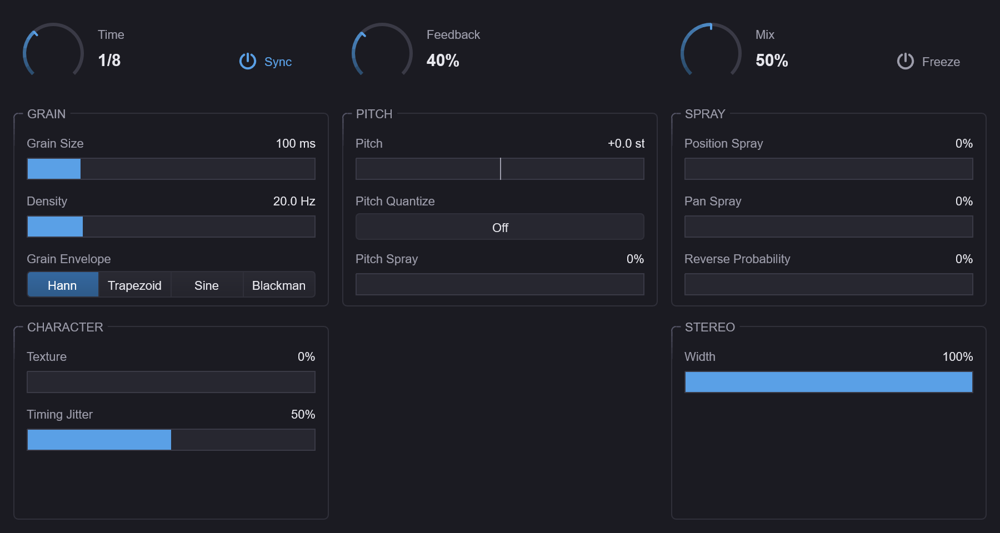

Granular rebuilds the delay from short grains. The input, plus the feedback, is written to a grain buffer; a scheduler
fires grains that each read a short window of that buffer with its own pitch, position, pan, direction and level. The
sum of the grains is softly limited, and that limited signal is both the wet output and what feeds back. **Freeze**
stops the buffer from recording, so the grains keep playing what it holds.

| Control | Host name | Range | Default | What it does |
|---|---|---|---|---|
| Time | Delay Time · Time Mode · Note Value | 0–2000 ms, or a note value | Synced, 1/8 | How far back the grains read. |
| Feedback | Feedback | 0–120 % | 40 % | Grain output fed back into the buffer. |
| Mix | Dry/Wet | 0–100 % | 50 % | Dry/wet balance. |
| Freeze | Freeze | Off / On | Off | Holds the grain buffer: grains keep playing what it contains. |
| Grain Size | Grain Size | 10–500 ms | 100 ms | Length of each grain. |
| Density | Density | 1–100 grains/s | 20 | How many grains start each second. |
| Grain Envelope | Envelope | Hann, Trapezoid, Sine, Blackman | Hann | The shape each grain fades in and out with. |
| Pitch | Pitch | −24 to +24 semitones | 0 | Pitch of every grain. |
| Pitch Quantize | Pitch Quant | Off, Semitones, Octaves, Fifths, Scale | Off | Snaps the grain pitch (including Pitch Spray) to semitones, octaves, fifths or the degrees of a major scale. |
| Pitch Spray | Pitch Spray | 0–100 % | 0 % | Random pitch variation per grain. |
| Position Spray | Position Spray | 0–100 % | 0 % | Random variation of where in the buffer each grain reads. |
| Pan Spray | Pan Spray | 0–100 % | 0 % | Random stereo position per grain. |
| Reverse Probability | Reverse Prob | 0–100 % | 0 % | The chance that a grain plays backwards. |
| Texture | Texture | 0–100 % | 0 % | Random level variation per grain: smooth at 0 %, grainy and uneven at 100 %. |
| Timing Jitter | Jitter | 0–100 % | 50 % | Randomness of the grain start times; 0 % is a steady stream. |
| Width | Stereo Width | 0–100 % | 100 % | Stereo width of the output (mid/side). |

## Spectral

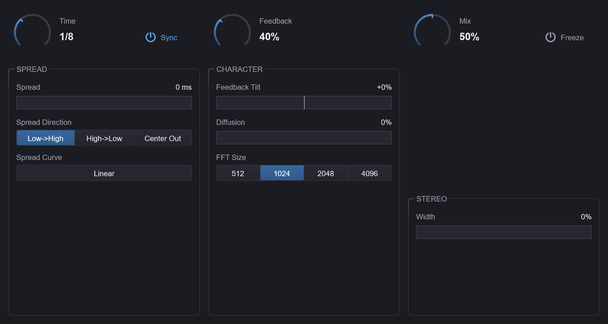

Spectral splits the signal into frequency bands with an FFT and delays each band by its own amount, so an echo smears
across the spectrum: low frequencies first and highs later, or the other way round. Each band has its own feedback,
which **Feedback Tilt** can weight towards the lows or the highs. **Freeze** captures the current spectrum and holds it.
Echo timing is quantised to the FFT hop (about 10.7 ms at 48 kHz at the default 1024-point FFT size), so a tempo-synced
echo can sit up to about 5 ms off the grid.

| Control | Host name | Range | Default | What it does |
|---|---|---|---|---|
| Time | Base Delay · Time Mode · Note Value | 0–2000 ms, or a note value | Synced, 1/8 | The delay of the first band. |
| Feedback | Feedback | 0–120 % | 40 % | Per-band feedback. |
| Mix | Dry/Wet | 0–100 % | 50 % | Dry/wet balance. |
| Freeze | Freeze | Off / On | Off | Holds the current spectrum. |
| Spread | Spread | 0–2000 ms | 0 ms | The extra delay across the bands; 0 makes every band arrive together. |
| Spread Direction | Spread Dir | Low->High, High->Low, Center Out | Low->High | Which bands arrive first. Center Out delays the extremes most. |
| Spread Curve | Spread Curve | Linear, Logarithmic, Exponential, Steps, Scatter, Random | Linear | How the spread is shared out over the octaves (20 Hz to 20 kHz). Linear: an equal share per octave, a smooth sweep. Logarithmic: the low octaves get most of it. Exponential: the lows and mids return together, then the highs trail out. Steps: 8 bands, each a separate echo. Scatter: third-octave bands in a fixed shuffled order. Random: the bands keep moving to new delays. |
| Feedback Tilt | Feedback Tilt | −100 to +100 % | 0 % | Negative favours the lows in the feedback, positive the highs. |
| Diffusion | Diffusion | 0–100 % | 0 % | Blurs neighbouring bands together for a softer, washier tail. |
| FFT Size | FFT Size | 512, 1024, 2048, 4096 | 1024 | Larger sizes resolve frequency more finely but smear time more. |
| Width | Stereo Width | 0–100 % | 0 % | Stereo decorrelation between the left and right spectra. |

## Shimmer

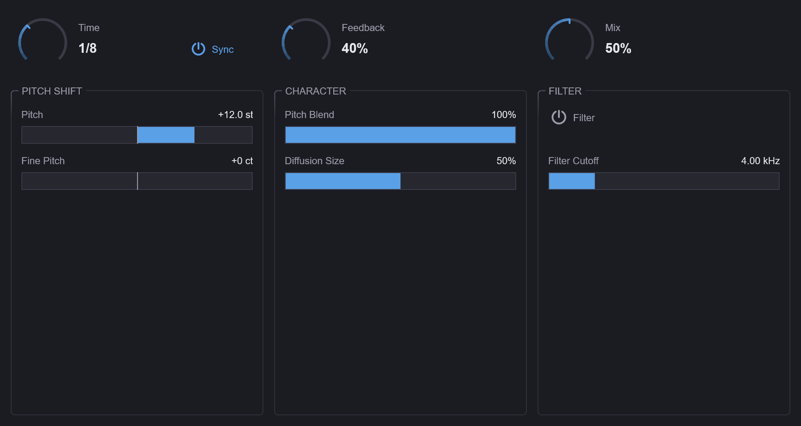

Shimmer pitch-shifts its feedback, so each repeat climbs (or falls) further: an octave up by default, the classic
shimmer sound. The delayed signal runs through a pitch shifter and a diffuser; **Pitch Blend** chooses how much of the
feedback takes that pitched path. An optional low-pass filter and a limiter sit in the loop too.

| Control | Host name | Range | Default | What it does |
|---|---|---|---|---|
| Time | Delay Time · Shimmer Time Mode · Shimmer Note Value | 10–5000 ms, or a note value | Synced, 1/8 | Delay time. |
| Feedback | Feedback | 0–120 % | 40 % | Feedback amount. |
| Mix | Dry/Wet | 0–100 % | 50 % | Dry/wet balance. |
| Pitch | Pitch | −24 to +24 semitones | +12 | Pitch shift per repeat. |
| Fine Pitch | Fine Tune | −100 to +100 cents | 0 | Fine pitch offset; a few cents gives a slowly detuning wash. |
| Pitch Blend | Shimmer Mix | 0–100 % | 100 % | How much of the feedback is pitch-shifted; at 0 % Shimmer is a plain diffused delay. |
| Diffusion Size | Diff Size | 0–100 % | 50 % | Size of the diffuser after the pitch shifter. |
| Filter | Filter | Off / On | Off | Switches the low-pass filter in the feedback loop. |
| Filter Cutoff | Filter Cutoff | 20 Hz – 20 kHz | 4 kHz | Cutoff of that filter: lower values darken each repeat. |

## Tape

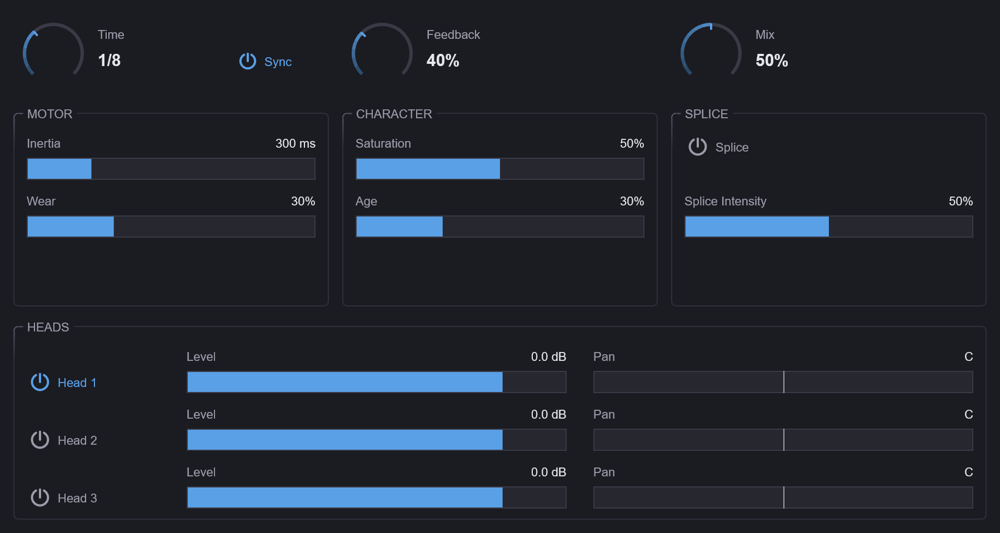

Tape models a tape echo with three playback heads. The input is recorded onto one tape; the heads read it at once,
1.5 and 2 times the delay time, each with its own level and pan. Every enabled head feeds back into the tape. The
tape character (wow and flutter, saturation, ageing and hiss) colours the heads' output, and optional splice clicks
mark each pass of the tape loop.

| Control | Host name | Range | Default | What it does |
|---|---|---|---|---|
| Time | Tape Motor Speed · Tape Time Mode · Tape Note Value | 20–2000 ms, or a note value | Synced, 1/8 | The delay of Head 1 (the motor speed). |
| Feedback | Tape Feedback | 0–120 % | 40 % | Feedback from each enabled head. |
| Mix | Tape Mix | 0–100 % | 50 % | Dry/wet balance. |
| Inertia | Tape Motor Inertia | 100–1000 ms | 300 ms | How long the motor takes to reach a new speed: a time change glides in pitch, like a real tape machine. |
| Wear | Tape Wear | 0–100 % | 30 % | Wow and flutter depth, and hiss. |
| Saturation | Tape Saturation | 0–100 % | 50 % | Tape drive and warmth. |
| Age | Tape Age | 0–100 % | 30 % | High-frequency roll-off (from 12 kHz down to 4 kHz), noise and artefacts. |
| Splice | Tape Splice Enable | Off / On | Off | A splice click each time the tape loop comes round. |
| Splice Intensity | Tape Splice Intensity | 0–100 % | 50 % | Loudness of the splice clicks. |
| Head 1 / 2 / 3 | Tape Head 1 Enable · Tape Head 2 Enable · Tape Head 3 Enable | Off / On | Head 1 on, Heads 2 and 3 off | Switches each head. The heads sit at 1×, 1.5× and 2× the delay time. |
| Level | Tape Head 1 Level · Tape Head 2 Level · Tape Head 3 Level | −30 to +6 dB | 0 dB | Level of each head. |
| Pan | Tape Head 1 Pan · Tape Head 2 Pan · Tape Head 3 Pan | L100 to R100 | C | Stereo position of each head. |

## BBD

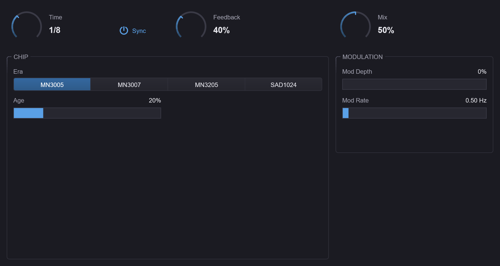

BBD models a bucket-brigade delay chip. A compander squeezes the signal before the chip and expands it after; inside
the feedback loop the chip's limited bandwidth darkens each repeat, followed by gentle saturation. A triangle LFO
modulates the delay time for chorus and vibrato. **Era** picks the chip, and **Age** wears it out.

| Control | Host name | Range | Default | What it does |
|---|---|---|---|---|
| Time | BBD Delay Time · BBD Time Mode · BBD Note Value | 20–1000 ms, or a note value | Synced, 1/8 | Delay time. |
| Feedback | BBD Feedback | 0–120 % | 40 % | Feedback amount. |
| Mix | BBD Mix | 0–100 % | 50 % | Dry/wet balance. |
| Era | BBD Era | MN3005, MN3007, MN3205, SAD1024 | MN3005 | The chip model: its bandwidth, drive and noise. |
| Age | BBD Age | 0–100 % | 20 % | Noise, bandwidth loss and compander artefacts of an older chip. |
| Mod Depth | BBD Mod Depth | 0–100 % | 0 % | Depth of the delay-time modulation (up to ±5 % of the time). |
| Mod Rate | BBD Mod Rate | 0.1–10 Hz | 0.50 Hz | Speed of the modulation. |

## Digital

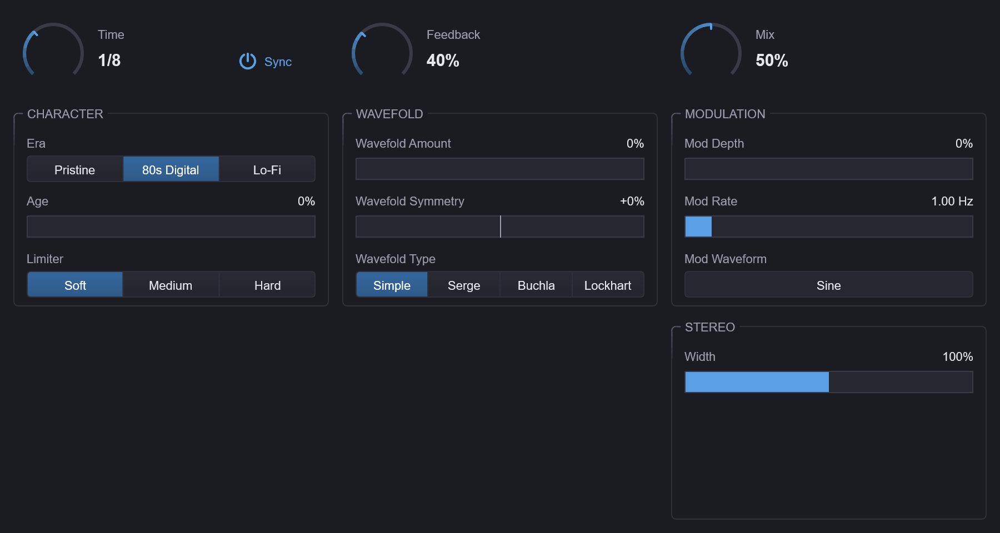

Digital is a clean delay that can be roughened on purpose. Pristine is transparent; **80s Digital** adds the filtering
and reduced sample rate of early digital units, and **Lo-Fi** goes further with bit and sample-rate reduction. A
wavefolder and a limiter shape the output, and an LFO with six waveforms modulates the delay time.

| Control | Host name | Range | Default | What it does |
|---|---|---|---|---|
| Time | Digital Delay Time · Digital Time Mode · Digital Note Value | 1–10000 ms, or a note value | Synced, 1/8 | Delay time. |
| Feedback | Digital Feedback | 0–120 % | 40 % | Feedback amount. |
| Mix | Digital Mix | 0–100 % | 50 % | Dry/wet balance. |
| Era | Digital Era | Pristine, 80s Digital, Lo-Fi | Pristine | The character of the converter. |
| Age | Digital Age | 0–100 % | 0 % | How worn the converter sounds. Shown only when Era is not Pristine (as in the picture above). |
| Limiter | Digital Limiter | Soft, Medium, Hard | Soft | The knee of the output limiter, which keeps high feedback in check. |
| Wavefold Amount | Digital Wavefold | 0–100 % | 0 % | Folds the echoes back on themselves for added harmonics; 0 % is off. |
| Wavefold Type | Digital Wavefold Type | Simple, Serge, Buchla, Lockhart | Simple | The folding circuit. |
| Wavefold Symmetry | Digital Wavefold Sym | −100 to +100 % | 0 % | Makes the folding asymmetric for even harmonics. |
| Mod Depth | Digital Mod Depth | 0–100 % | 0 % | Depth of the delay-time modulation (up to ±10 % of the time). |
| Mod Rate | Digital Mod Rate | 0.1–10 Hz | 1.00 Hz | Speed of the modulation. |
| Mod Waveform | Digital Mod Waveform | Sine, Triangle, Saw Up, Saw Down, Square, Random | Sine | Shape of the modulation. |
| Width | Digital Width | 0–200 % | 100 % | Stereo width of the echoes: 0 % mono, 100 % as recorded, 200 % widest. |

## PingPong

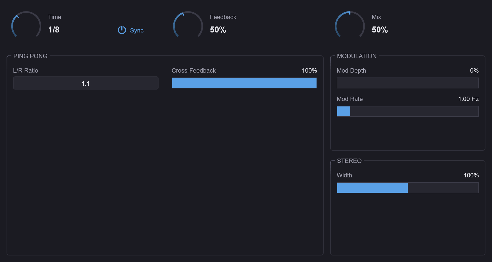

PingPong bounces the echoes between left and right. Each side has its own delay line; **L/R Ratio** sets their times
relative to each other, and **Cross-Feedback** decides how much each repeat crosses to the other side: at 100 % every
repeat swaps sides (full ping-pong), at 0 % the two sides echo independently. Two LFOs, a quarter cycle apart,
modulate the two delay times.

| Control | Host name | Range | Default | What it does |
|---|---|---|---|---|
| Time | PingPong Delay Time · PingPong Time Mode · PingPong Note Value | 1–10000 ms, or a note value | Synced, 1/8 | Base delay time. |
| Feedback | PingPong Feedback | 0–120 % | 50 % | Feedback amount. |
| Mix | PingPong Mix | 0–100 % | 50 % | Dry/wet balance. |
| L/R Ratio | PingPong L/R Ratio | 1:1, 2:1, 3:2, 4:3, 1:2, 2:3, 3:4 | 1:1 | Ratio of the left to the right delay time, for polyrhythmic bounces. |
| Cross-Feedback | PingPong Cross-Feedback | 0–100 % | 100 % | 0 % = two independent echoes, 100 % = full ping-pong. |
| Mod Depth | PingPong Mod Depth | 0–100 % | 0 % | Depth of the delay-time modulation (up to ±10 %). |
| Mod Rate | PingPong Mod Rate | 0.1–10 Hz | 1.00 Hz | Speed of the modulation. |
| Width | PingPong Width | 0–200 % | 100 % | Stereo width of the echoes. |

## Reverse

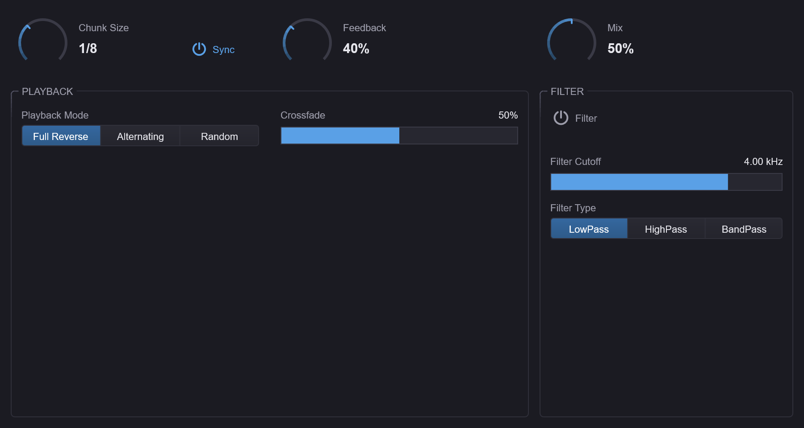

Reverse records the input in chunks and plays each chunk backwards, so every echo swells in instead of decaying.
**Playback Mode** can alternate forward and reversed chunks or choose at random, and **Crossfade** smooths the joins
between chunks. A filter and a limiter sit in the feedback loop.

| Control | Host name | Range | Default | What it does |
|---|---|---|---|---|
| Chunk Size | Reverse Chunk Size · Reverse Time Mode · Reverse Note Value | 10–2000 ms, or a note value | Synced, 1/8 | Length of each reversed chunk. |
| Feedback | Reverse Feedback | 0–120 % | 40 % | Feedback amount. |
| Mix | Reverse Dry/Wet | 0–100 % | 50 % | Dry/wet balance. |
| Playback Mode | Reverse Playback Mode | Full Reverse, Alternating, Random | Full Reverse | Every chunk reversed, alternately forward and reversed, or a random choice per chunk. |
| Crossfade | Reverse Crossfade | 0–100 % | 50 % | The crossfade between chunks, as a share of the chunk length. |
| Filter | Reverse Filter Enable | Off / On | Off | Switches the filter in the feedback loop. |
| Filter Cutoff | Reverse Filter Cutoff | 20 Hz – 20 kHz | 4 kHz | Cutoff of that filter. |
| Filter Type | Reverse Filter Type | LowPass, HighPass, BandPass | LowPass | Filter type. |

## MultiTap

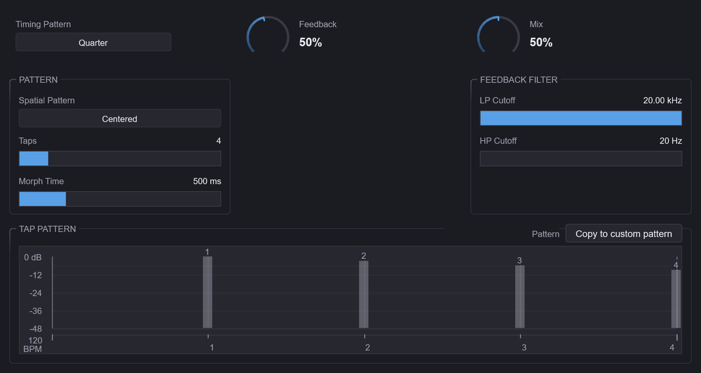

MultiTap places 2 to 16 taps on one delay line in a rhythm. The rhythmic patterns (Whole to Triplet 16th) follow the
host tempo directly; the mathematical patterns (Golden Ratio, Fibonacci, Exponential, Primes, Linear) are measured in
units of **Note Value**. **Spatial Pattern** gives each tap its level and stereo position. When you choose a new
pattern with the same number of taps, the taps glide to their new places over **Morph Time**. **Custom** lets you draw
your own pattern in the tap editor.

MultiTap has no Sync switch: its timing always comes from the host tempo.

| Control | Host name | Range | Default | What it does |
|---|---|---|---|---|
| Timing Pattern | MultiTap Timing Pattern | Whole, Half, Quarter, Eighth, 16th, 32nd, Dotted Half, Dotted Qtr, Dotted 8th, Dotted 16th, Triplet Half, Triplet Qtr, Triplet 8th, Triplet 16th, Golden Ratio, Fibonacci, Exponential, Primes, Linear, Custom | Quarter | Where the taps fall. |
| Feedback | MultiTap Feedback | 0–110 % | 50 % | Feedback amount. |
| Mix | MultiTap Dry/Wet | 0–100 % | 50 % | Dry/wet balance. |
| Spatial Pattern | MultiTap Spatial Pattern | Cascade, Alternating, Centered, Widening, Decaying, Flat, Custom | Centered | Level and pan of each tap. |
| Taps | MultiTap Tap Count | 2–16 | 4 | Number of taps. |
| Morph Time | MultiTap Morph Time | 50–2000 ms | 500 ms | Glide time when the pattern changes and the tap count stays the same. |
| Note Value | MultiTap Note Value | Whole, Half, Quarter, 8th, 16th, 32nd, 64th, 128th, 1/2T, 1/4T | Quarter | The time unit of the mathematical patterns. Shown only for those patterns. |
| Note Modifier | MultiTap Note Modifier | None, Triplet, Dotted | None | Makes that unit a triplet or dotted value. |
| LP Cutoff | MultiTap Feedback LP | 20 Hz – 20 kHz | 20 kHz | Low-pass filter in the feedback: lower values darken the repeats. |
| HP Cutoff | MultiTap Feedback HP | 20 Hz – 20 kHz | 20 Hz | High-pass filter in the feedback: higher values thin out the repeats. |
| Pattern Length | MultiTap Custom Length | Free, 1/8, 1/4, 1/2, 1/1, 2/1 | 1/1 | The span of the Custom pattern's timeline. Free is a 5 second span. Custom only. |
| Snap | MultiTap Snap | Off, 1/64T … 1/1D | 1/4 | The grid that tap drags snap to. Custom only. |

### The tap pattern editor

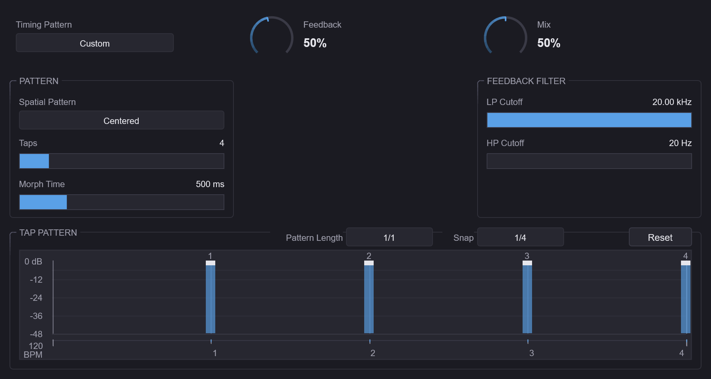

The strip along the bottom of the MultiTap panel is the tap pattern editor. Time runs from left to right across the
pattern length; level runs from 0 dB at the top down to −48 dB, with a silence band below that. A ruler shows the
beats, the snap grid and the current tempo.

On a preset pattern the editor is **read-only**: it shows where the pattern places its taps at the current tempo, and a
**Copy to custom pattern** button copies those times and levels into the Custom pattern and switches to it. On the
**Custom** pattern the editor is live:

| Action | Result |
|---|---|
| Hover a tap | A readout shows its grid position, time and level. |
| Drag a tap's bar | Moves it in time. |
| Drag a tap's top handle | Changes its level. |
| Drag a short or silent tap | The first movement decides whether the drag moves time or level. |
| Shift while dragging | Fine control, and ignores the snap grid. |
| Double-click a tap | Returns it to its default place at 0 dB. |
| Ctrl-click (Cmd-click on macOS) a tap | Sets its level to 0 dB. |
| Esc while dragging | Cancels the drag. |
| **Reset** | Puts every tap back at its default place, at 0 dB. |

Raising **Taps** reveals new taps; a new tap whose place is already taken moves to the nearest free grid line. Taps
later than 5 seconds play at 5 seconds.

The custom pattern is stored in 32 automatable host parameters, **Custom Time** 1–16 (each tap's place on the
timeline) and **Custom Level** 1–16 (each tap's level). The editor writes them; they have no other control.

## Freeze

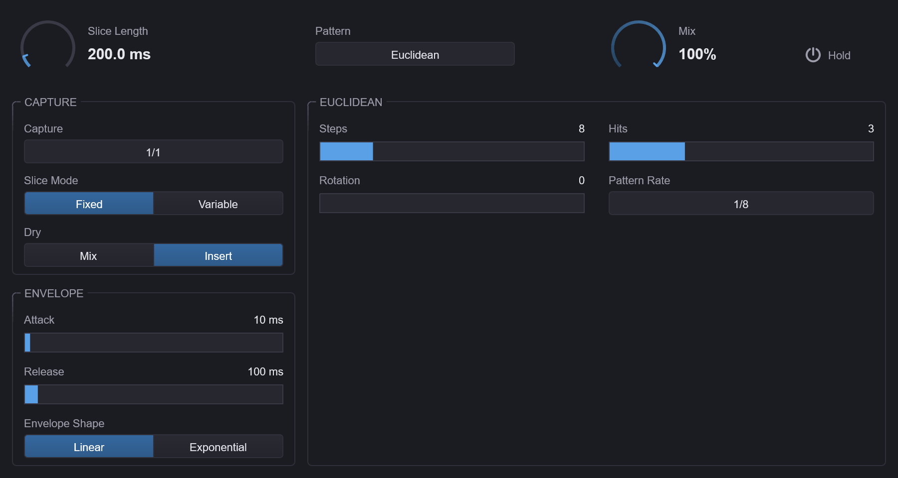

Freeze turns the delay into a rhythmic sampler. It records the input in windows one **Capture** cycle long, locked to
the bar, and plays the newest window back in a pattern: Euclidean rhythms, scattered grains, harmonic drones or noise
bursts. **Hold** stops capturing and keeps playing the current window. Freeze has no feedback.

| Control | Host name | Range | Default | What it does |
|---|---|---|---|---|
| Slice Length | Freeze Slice Length | 10–2000 ms | 200 ms | Length of each slice a hit plays. |
| Pattern | Freeze Pattern Type | Euclidean, Granular Scatter, Harmonic Drones, Noise Bursts | Euclidean | How the window is played back. |
| Mix | Freeze Dry/Wet | 0–100 % | 100 % | Dry/wet balance. |
| Hold | Freeze Hold | Off / On | Off | Keeps playing the current window instead of capturing new ones. |
| Capture | Freeze Capture | 1/4, 1/2, 1/1, 2/1 | 1/1 | Length of each captured window, in bars of 4/4 at the host tempo. |
| Slice Mode | Freeze Slice Mode | Fixed, Variable | Fixed | Fixed replays the window from its downbeat; Variable plays from the matching place in the bar. |
| Dry | Freeze Dry Mode | Mix, Insert | Insert | Mix crossfades dry and wet by Mix. Insert keeps the dry signal and ducks it only while a slice plays. |
| Attack | Freeze Envelope Attack | 0–500 ms | 10 ms | Fade-in of each slice, grain, drone and burst. |
| Release | Freeze Envelope Release | 0–2000 ms | 100 ms | Fade-out. |
| Envelope Shape | Freeze Envelope Shape | Linear, Exponential | Linear | Curve of the fades. |

The right side of the panel shows the controls of the selected pattern.

**Euclidean** spreads a number of hits as evenly as possible over a number of steps and plays a slice on each hit.

| Control | Host name | Range | Default | What it does |
|---|---|---|---|---|
| Steps | Freeze Euclidean Steps | 2–32 | 8 | Steps in the rhythm. |
| Hits | Freeze Euclidean Hits | 1 to Steps | 3 | Hits spread over the steps. |
| Rotation | Freeze Euclidean Rotation | 0 to Steps − 1 | 0 | Rotates the rhythm by whole steps. |
| Pattern Rate | Freeze Pattern Rate | a note value | 1/8 | Length of one step, at the host tempo. |

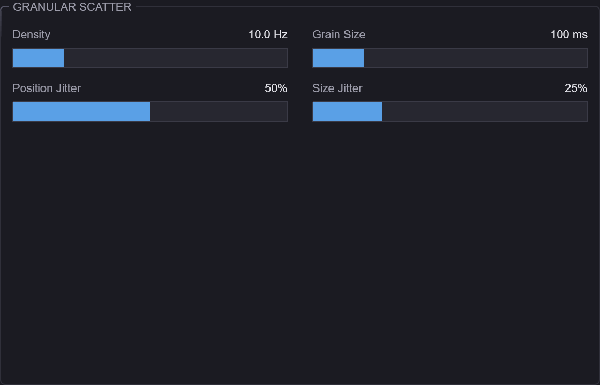

**Granular Scatter** plays grains from the window at random moments.

| Control | Host name | Range | Default | What it does |
|---|---|---|---|---|
| Density | Freeze Granular Density | 1–50 Hz | 10 Hz | Average number of grains per second. |
| Grain Size | Freeze Grain Size | 10–500 ms | 100 ms | Length of each grain. |
| Position Jitter | Freeze Position Jitter | 0–100 % | 50 % | How widely the grains wander through the window. |
| Size Jitter | Freeze Size Jitter | 0–100 % | 25 % | Random variation of the grain length. |

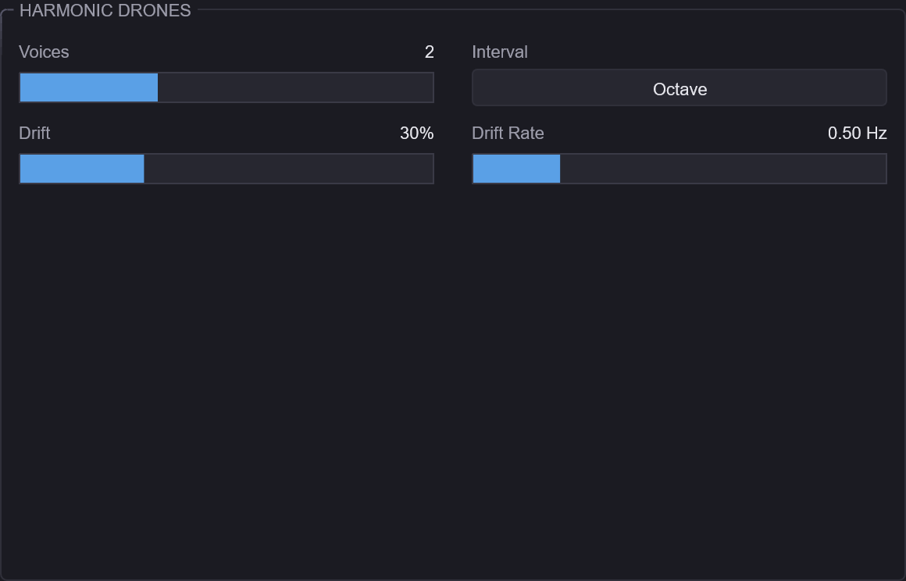

**Harmonic Drones** sustains the window as a drone, with up to three pitch-shifted voice pairs above the root.

| Control | Host name | Range | Default | What it does |
|---|---|---|---|---|
| Voices | Freeze Drone Voices | 1–4 | 2 | The root plus up to three shifted voices. |
| Interval | Freeze Drone Interval | Unison, Minor 3rd, Major 3rd, Perfect 4th, Perfect 5th, Octave | Octave | The interval between the voices. |
| Drift | Freeze Drone Drift | 0–100 % | 30 % | Slow pitch drift of the voices. |
| Drift Rate | Freeze Drift Rate | 0.1–2.0 Hz | 0.50 Hz | Speed of that drift. |

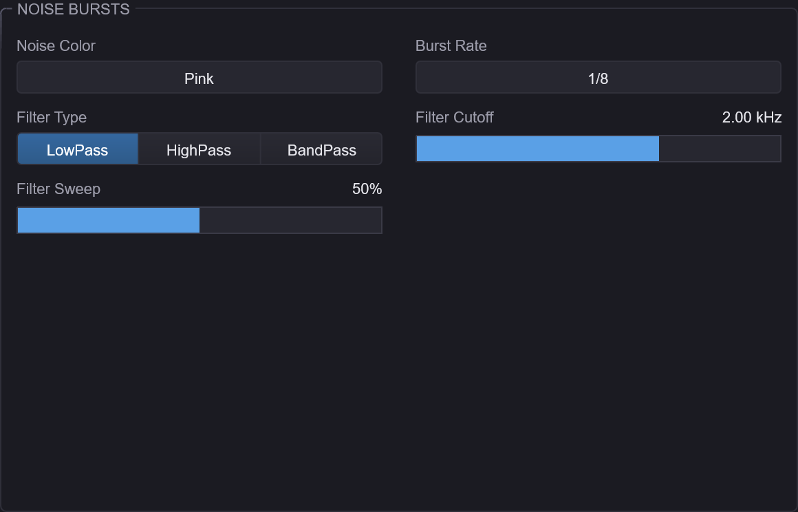

**Noise Bursts** plays a slice together with a burst of filtered noise on each beat of **Burst Rate**.

| Control | Host name | Range | Default | What it does |
|---|---|---|---|---|
| Noise Color | Freeze Noise Color | White, Pink, Brown, Blue, Violet, Grey, Velvet, Radio | Pink | The colour of the noise. |
| Burst Rate | Freeze Noise Burst Rate | a note value | 1/8 | Time between bursts, at the host tempo. |
| Filter Type | Freeze Noise Filter Type | LowPass, HighPass, BandPass | LowPass | Filter on the noise. |
| Filter Cutoff | Freeze Noise Filter Cutoff | 20 Hz – 20 kHz | 2 kHz | Cutoff of that filter. |
| Filter Sweep | Freeze Noise Filter Sweep | 0–100 % | 50 % | How far the cutoff sweeps down during each burst. |

## Presets

**Presets** in the footer opens the preset browser over the whole editor. It opens on the tab of the current mode;
the tabs are **All** plus one per mode. Type in the search field to filter, and double-click a preset to load it and
close the browser. Loading a preset also switches to its mode. The browser's **Save**, **Import...** and **Delete**
buttons manage your own presets; factory presets cannot be deleted. Esc closes the browser.

**Save Preset** in the footer opens a small dialog: type a name, pick a category (the current mode is selected) and
click **Save**. Iterum asks before overwriting a preset of the same name.

### Factory library

Iterum ships 101 factory presets, at least ten per mode. The browser shows them by file name.

- **Granular** — `Ambient_Drift`, `Cloud_Nine`, `Frozen_Moment`, `Grain_Cascade`, `Grain_Storm`, `LoFi_Clouds`,
  `Micro_Slice`, `Stutter_Step`, `Time_Warp`, `Whisper_Trail`
- **Spectral** — `Crystal_Diffusion`, `Frequency_Cascade`, `Ghost_Frequencies`, `Low_End_Spread`, `Mono_to_Wide`,
  `Prism`, `Rainbow_Scatter`, `Resonant_Sweep`, `Spectral_Freeze`, `Treble_Trail`
- **Shimmer** — `Bright_Stars`, `Cathedral`, `Dark_Shimmer`, `Detune_Wash`, `Fifth_Up`, `Heavenly`, `Infinite_Rise`,
  `Octave_Below`, `Subtle_Shine`, `Vocal_Halo`
- **Tape** — `LoFi_Groove`, `Old_Radio`, `Slapback_Echo`, `Splice_Madness`, `Studio_Reel`, `Tape_Saturation`,
  `VHS_Memory`, `Vintage_Dub`, `Warm_Bass`, `Worn_Cassette`
- **BBD** — `Analog_Dreams`, `Classic_Chorus`, `Clean_Repeat`, `Dark_Bucket`, `Drum_Pocket`, `Murky_Depths`,
  `Space_Echo`, `Subtle_Widen`, `Synth_Lead`, `Vintage_Flange`
- **Digital** — `Clean_Vocal`, `Crystal_Clear`, `Dotted_Eighth`, `Long_Tail`, `Modulated_Space`, `Ping_Pong_Lite`,
  `Precise_Hit`, `Rhythmic_Sync`, `Subtle_Room`, `Wide_Stereo`
- **PingPong** — `Asymmetric`, `Guitar_Spread`, `Modulated_Space`, `Rhythmic_Tennis`, `Slow_Motion`, `Subtle_Bounce`,
  `Synth_Panorama`, `Tight_Pocket`, `Vocal_Depth`, `Wide_Pong`
- **Reverse** — `Alternating_Reality`, `Backward_Glance`, `Drum_Reverse`, `Filtered_Ghost`, `Ghostly`,
  `Long_Tail_Reverse`, `Random_Chaos`, `Short_Flip`, `Swell_Up`, `Vocal_Spirit`
- **MultiTap** — `Alternating_Stereo`, `Cascading_Echoes`, `Dub_Echoes`, `Fibonacci_Rhythm`, `Golden_Ratio`,
  `Prime_Numbers`, `Sixteenth_Grid`, `Slow_Buildup`, `Tight_Pocket`, `Wide_Taps`
- **Freeze** — `Euclidean_Pulse`, `Fifths_Drone`, `Ghost_Pattern`, `Granular_Cloud`, `Harmonic_Bed`, `Noise_Texture`,
  `Radio_Static`, `Scatter_Drift`, `Slice_Machine`, `Stutter_Fill`, `Total_Freeze`

## Host Automation

Every control above is automatable, under the host name in its table. Each mode's parameters keep their values while
another mode plays, so you can automate **Mode** to switch between prepared settings. Automation is applied once per
processing block.

## Tips & Tricks

- **Instant dub:** Tape with Heads 2 and 3 on, Feedback around 70 % and Age up; ride Feedback past 100 % for a
  runaway swell, then pull it back.
- **Pitch-gliding repeats:** in Tape, raise Inertia and turn the Time knob (with Sync off): the motor slows and speeds
  up, bending the pitch of the echoes.
- **Shimmer pads:** Pitch +12, Pitch Blend 100 %, Feedback 80–90 %, Filter on around 6 kHz to keep the top end soft.
- **Polyrhythmic bounce:** PingPong with L/R Ratio 3:2 and Cross-Feedback 100 %.
- **Rhythmic stutter on a loop:** Freeze, Euclidean, Steps 16, Hits 5, Dry on Insert: the dry signal plays on and the
  slices cut in on the hits.
- **Make a preset pattern your own:** in MultiTap pick a pattern close to what you want, press **Copy to custom
  pattern**, then drag the taps.
